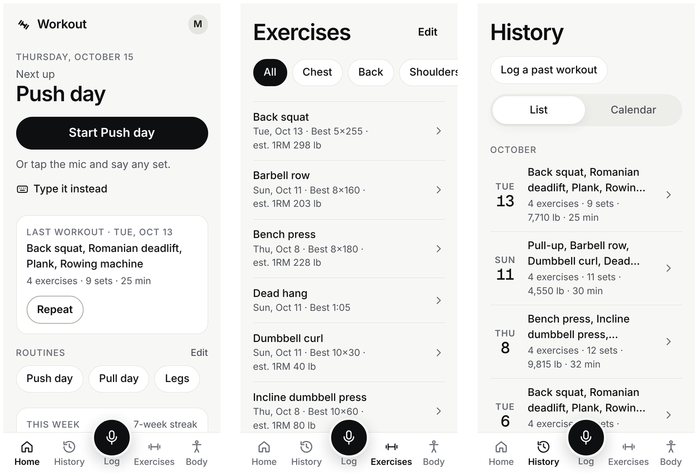
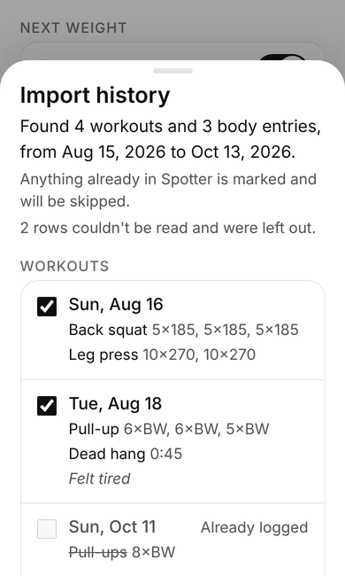

# Spotter

**A workout log you can talk to.** Tap the mic, say what you just did, and Spotter turns it into sets. It works on your phone and your computer, keeps working when the gym has no signal, and shows how you are progressing over time.

**Open the app:** [repsandsets.vercel.app](https://repsandsets.vercel.app)



## Contents

- [What Spotter does](#what-spotter-does)
- [Getting started](#getting-started)
- [Install it on your phone or computer](#install-it-on-your-phone-or-computer)
- [Logging a workout](#logging-a-workout)
- [Finding your way around](#finding-your-way-around)
- [Routines and supersets](#routines-and-supersets)
- [Import your history from a file](#import-your-history-from-a-file)
- [Export your data](#export-your-data)
- [Using it without a connection](#using-it-without-a-connection)
- [Settings](#settings)
- [Tips and troubleshooting](#tips-and-troubleshooting)
- [For developers](#for-developers)

## What Spotter does

- **Log by voice or by typing.** Say "bench press, three sets of ten at 135" and check the result before it is saved.
- **Any kind of exercise.** Reps and weight, a time (a plank), or a distance (a row), with an optional RPE. There is no fixed exercise list; type any name.
- **See your progress.** Each exercise has its best set, an estimated one-rep max, and a trend. Home compares this week with last week.
- **See what you have trained.** A front and back body map shades each muscle group by this week's sets and lists the groups you have skipped.
- **Routines.** Save a plan, start it in one tap, and get a suggested weight with the reason behind it.
- **Bring your history with you.** Import from a spreadsheet, another app's export, a PDF, or a photo of a notebook.
- **Your data is yours.** Download everything as spreadsheets at any time.

## Getting started

1. Open [repsandsets.vercel.app](https://repsandsets.vercel.app) in your browser.
2. Sign in with your Google account.
3. Tap the mic in the middle of the bottom bar and say your first set. The first set you confirm starts the workout.

Spotter works in pounds by default. To use kilograms, open **Settings** (your avatar in the top right) and change **Weight**.

## Install it on your phone or computer

Spotter is a web app you can install. It gets its own icon, opens full screen like any other app, and updates itself. There is nothing to download from an app store.

### iPhone and iPad

1. Open the site in **Safari** (or Chrome, on iOS 16.4 and later).
2. Tap the **Share** button.
3. Tap **Add to Home Screen**, then **Add**.

### Android

1. Open the site in **Chrome**.
2. Go to **Settings > App > Install app**, or open Chrome's **⋮** menu and choose **Install app** (or **Add to Home screen**).
3. Confirm, and Spotter appears in your app drawer.

### Windows, Mac, and Linux

1. Open the site in **Chrome** or **Edge**.
2. Go to **Settings > App > Install app**, or click the install icon at the right end of the address bar.
3. Spotter opens in its own window and can be pinned to your taskbar or Dock.

Once installed, press and hold the app icon (or right-click it on a computer) for shortcuts: **New workout**, **Repeat last workout**, **Routines**, and **Log body weight**.

## Logging a workout

### By voice

Tap the mic and speak naturally. You can describe several exercises at once:

| Say | You get |
| --- | --- |
| "Bench press, three sets of ten at 135, then rows, three sets of eight at 95" | Two exercises, three sets each |
| "Plank 60 seconds" | A timed set |
| "Superset curls and pushdowns, 3 rounds of 12 at 30 and 50" | Two exercises grouped as a superset |

Each exercise appears as its own block so you can fix anything that was misheard. Nothing is saved until you confirm.

### By typing or by hand

- Tap **Type it instead** and write it the short way, for example `squat 3x5 225`.
- Use the manual form to fill in a set field by field.
- Tap **+** on an exercise to log its last set again.

Every add shows **Undo**, and a workout can carry a short note.

### During and after a workout

- A rest timer starts after each set, and it chimes when rest is over.
- Each exercise page shows a demo with photos and steps. **Wrong demo?** lets you pick the right one, and **Watch a video** searches YouTube.
- When you finish, a recap shows your highlights, personal bests, and any badges you earned.
- Forgot to log one? Go to **History > Log a past workout** and pick the day.

## Finding your way around

The bar at the bottom of every screen:

| Tab | What's there |
| --- | --- |
| **Home** | Your next routine, your last workout with a **Repeat** button, this week against last week, and the body map. It becomes **Workout** while a workout is running. |
| **History** | Every workout as a list or a calendar. Open a day to edit sets, rename or remove an exercise, or delete the workout. |
| **Log** (mic) | Log by voice. With no connection it turns into **+** so you can add a set by hand. |
| **Exercises** | Every exercise with its last date and best set, filtered by muscle group. **Edit** renames an exercise or merges a duplicate into the one you keep. |
| **Body** | Body weight, body fat, and measurements such as waist, chest, and hips, with their history. You can log these by voice too. |

## Routines and supersets

Create a routine from **Home > Routines**. Starting a routine shows one exercise at a time ("Exercise 2 of 5") with what comes next, a **Skip** button, and **Show full plan** if you prefer the whole list. Spotter suggests the next weight and says why, for example "All 3 sets reached 8 reps last time, so 5 lb more."

Two or more neighbouring exercises can be a superset, either in a routine or during a workout. Rest starts after the whole round, and History shows the group as "Curl + Pushdown".

## Import your history from a file

Moving from another app or a paper log? Spotter can read it.

1. Go to **Settings > Your data > Import from a file**.
2. Pick a file. These all work:
   - a spreadsheet (`.xlsx` or `.csv`) or another app's export
   - a Word, text, or PDF file
   - a photo of a notebook page
   - a Spotter export zip
3. Wait while Spotter reads it. Keep the screen open until it finishes; long files are read in parts.
4. Review what was found. Untick anything you don't want. Anything already in Spotter for that day is marked and skipped, so importing the same file twice is safe.
5. Tap **Save**.



Workouts and body entries (weight, body fat, measurements) can come from the same file. Import needs a connection.

## Export your data

Go to **Settings > Your data > Download spreadsheet**. You get a zip with three spreadsheets: every set, every body entry, and every routine. Weights are listed in pounds, kilograms, and the unit you use. Export needs a connection.

## Using it without a connection

Gym signal is often weak, so sets you log by hand are saved on your phone first and marked as pending until they sync. Nothing is lost or doubled when you reconnect. Voice and typed logging need a connection; the manual form does not. Open Spotter at least once with a connection so it can work offline afterwards.

## Settings

Tap your avatar in the top right.

| Section | What you can change |
| --- | --- |
| **Weight** | Pounds or kilograms |
| **Measurements** | The unit for body measurements |
| **Rest** | Your default rest time |
| **Next weight** | How big a step suggested weights take |
| **Your data** | Download spreadsheet, Import from a file |
| **Appearance** | Light, dark, or match your phone |
| **App** | Install app (shown when your browser supports it) |
| **Account** | Sign out |

## Tips and troubleshooting

- **The mic doesn't work.** Allow microphone access for the site in your browser settings. You can always type the set instead.
- **No Install app button.** On iPhone use the browser's Share menu. Elsewhere, check that you are in Chrome or Edge and that Spotter isn't already installed.
- **An exercise shows up twice** ("Pull-up" and "Pull ups"). Go to **Exercises > Edit** and rename one to the other's name; their sets merge.
- **A set is marked pending.** It is saved on your phone and syncs when you are back online.

## For developers

Spotter is a Next.js app with a [Convex](https://www.convex.dev/) backend, Google sign-in through Convex Auth, and Gemini for voice and import parsing. It is hosted on Vercel; every push to `main` deploys to production.

```bash
npm install
cp .env.example .env.local
npx convex dev     # first terminal: backend
npm run dev        # second terminal: http://localhost:3000
```

Before opening a pull request, run `npm test`, `npm run lint`, `npm run typecheck`, and `npm run build`, the same checks CI runs.

Full setup, required keys, stats audits, manual test checklists, and deployment details are in [docs/DEVELOPMENT.md](docs/DEVELOPMENT.md).
